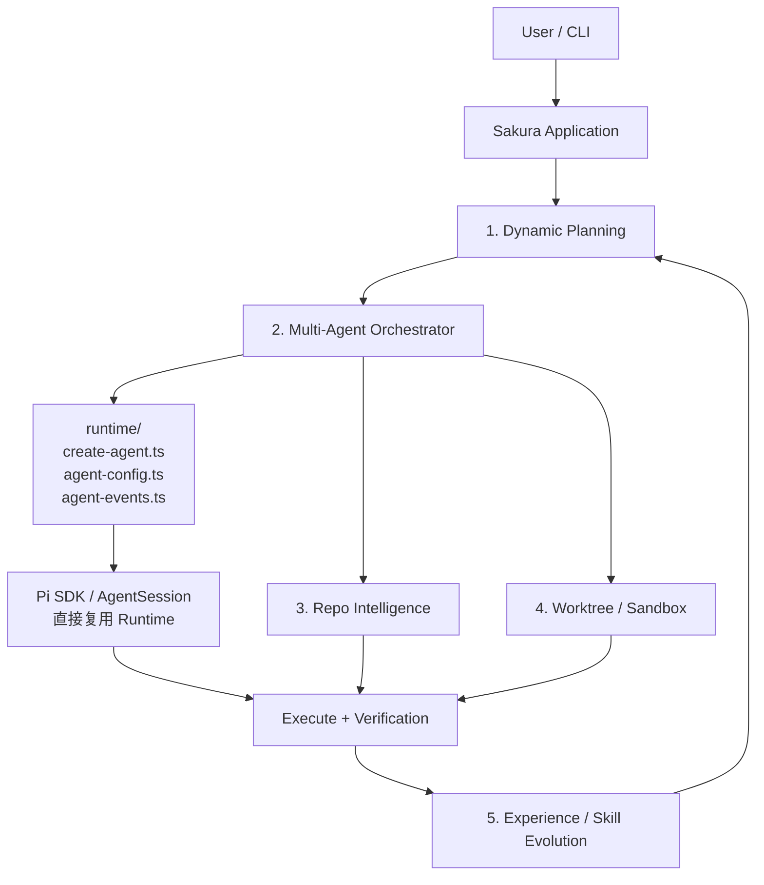
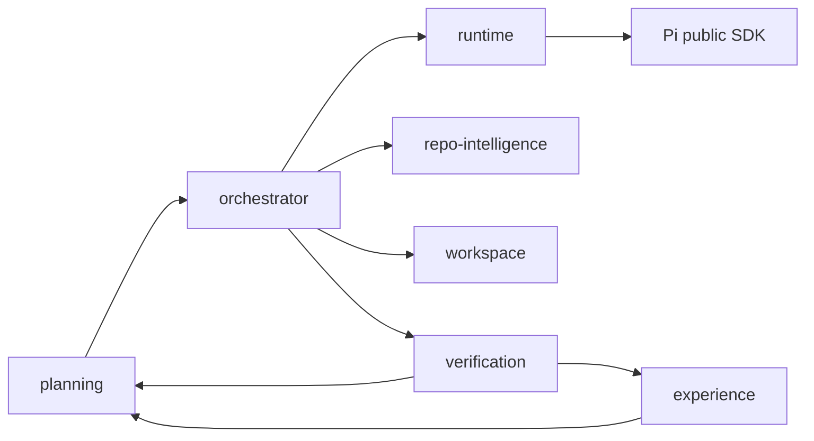
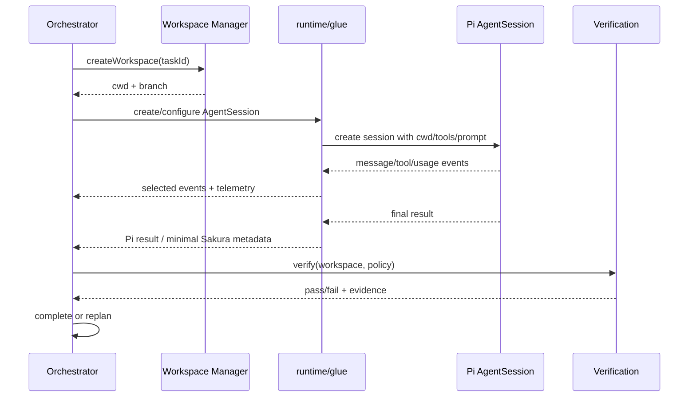

# Sakura Coding Agent：Pi 复用与防重复造轮子指南

> 本文是[可实施架构与开发路线](架构与开发路线.md)的配套文档，专门回答：**Pi 到底复用什么、怎么接入、哪些边界不能越过、Sakura 应该把代码写在哪里。**
>
> 目标不是把 Pi 改名成 Sakura，也不是为了“全自研”重写 Agent 基础设施，而是用稳定的 Pi Runtime 承载模型调用、Agent Loop、Session 和基础工具，把开发时间集中到 Sakura 的五个核心模块。

> **实施状态说明（2026-10-13）：** §15 的 checkbox 是供每个新 Issue 使用的空白 Reuse Check 模板，§16 是 Definition of Done 模板；它们不表示当前项目仍未执行。实际复用决策和未覆盖边界见[完成度审计](完成度审计.md)。早期路线提出的 Adapter 已按本文原则取消，当前通过官方 SDK 公开 API 直接集成。

---

## 1. 结论先行

Sakura 推荐采用下面的技术路线：

```text
主接入：Pi SDK（进程内嵌入）
辅助接入：Pi Extension API（命令、事件、工具、UI）
备用接入：Pi RPC（跨进程、跨语言、故障隔离）
避免接入：直接修改或长期 fork Pi core
```

一句话定义边界：

> **Pi 负责“让一个 Agent 稳定运行”，Sakura 负责“让多个 Agent 围绕真实仓库被正确规划、调度、隔离、验证和复盘”。**

Pi 当前官方定位本身就是可嵌入、可扩展的最小 Coding Agent Harness，支持 SDK、RPC、TypeScript Extensions、Skills 和 Packages。因此，Sakura 应优先组合这些公开能力，而不是复制内部实现。参考：[Pi Coding Agent README](https://github.com/earendil-works/pi/blob/main/packages/coding-agent/README.md)、[SDK Examples](https://github.com/earendil-works/pi/blob/main/packages/coding-agent/examples/sdk/README.md)、[RPC Mode](https://github.com/earendil-works/pi/blob/main/packages/coding-agent/docs/rpc.md)。

---

## 2. Sakura 与 Pi 的职责分界

| 能力 | 归属 | 实施方式 | 是否是 Sakura 卖点 |
|---|---|---|---|
| 多模型 Provider 与鉴权 | Pi | 直接复用 Pi 模型层 | 否 |
| 基础 Agent Loop | Pi | SDK 创建 `AgentSession` | 否 |
| Tool Call 循环与流式事件 | Pi | Session/Event API | 否 |
| Session 保存、分支、恢复 | Pi | `SessionManager` / Session API | 否 |
| Context compaction | Pi | 复用默认压缩，必要时通过扩展定制 | 否 |
| `read/write/edit/bash` | Pi | 原生工具白名单 | 否 |
| Skills 发现与加载 | Pi | `DefaultResourceLoader` + Sakura 策略层 | 部分 |
| MCP 协议接入 | 现有扩展/SDK | 统一转换到 Sakura Tool Registry | 否 |
| 单个 Subagent 的启动 | Pi SDK/参考现有扩展 | `PiAgent集成层.spawn()` | 否 |
| 动态任务规划与 Replanning | Sakura | 自研 Planner + Task DAG | 是 |
| 多 Agent 调度 | Sakura | 自研 Scheduler/Orchestrator | 是 |
| Repo Graph 与影响分析 | Sakura | 自研 Repo Intelligence | 是 |
| Worktree 隔离 | Sakura | 自研 Workspace Manager | 是 |
| 强权限隔离与 Sandbox | Sakura | 容器/沙箱后端 | 是 |
| Verification Loop | Sakura | 自研验证策略和失败反馈 | 是 |
| Experience/Skill Evolution | Sakura | 自研轨迹提取、检索、晋升 | 是 |
| Benchmark/Ablation | Sakura | 自研实验框架 | 是 |
| TUI/交互命令 | Pi | Extension API 扩展 | 否 |

### 2.1 一个判断规则

开发任何新模块前先问：

1. 这是“单 Agent 怎么运行”的问题吗？优先查 Pi。
2. 这是“多个任务/Agent 怎么组织”的问题吗？属于 Sakura。
3. 这是标准协议或基础设施吗？优先复用库或社区实现。
4. 这是论文/简历需要证明的差异化能力吗？Sakura 自研，并进入 Benchmark。
5. 能否通过公开 SDK、Extension 或 RPC 完成？能则不改 Pi core。

---

## 3. 总体复用架构

Sakura 不再把 Pi 集成层设计成独立核心模块，也不建立一套新的 `AgentRuntimePort → PiAdapter → Pi SDK` 抽象链。当前只有一种 Runtime（Pi）时，最简单可靠的方式是：**直接依赖 Pi 的公开 SDK，并用少量 integration/glue code 连接 Sakura 的五个自研模块。**



这里的 `runtime/` 只是很薄的集成代码，负责：

- 根据 Agent 角色配置 Prompt、模型和工具权限；
- 创建 Pi `AgentSession`；
- 将 Session 交给 Orchestrator 调度；
- 转发必要的运行事件；
- 收集 token、耗时、工具调用和错误等 Telemetry。

它**不是 Sakura 的第六个核心模块，不是独立 Runtime Framework，也不是项目卖点**。

当前禁止为了“解耦”而额外设计：

```text
AgentRuntimePort
    ↓
PiAdapter
    ↓
Pi SDK
```

只有未来真正接入第二种 Runtime，例如 Claude Code、OpenCode 或远程自研 Worker，并且两种 Runtime 已出现稳定的共同需求时，再基于实际差异抽取 Adapter/Port。

---

## 4. 三种 Pi 接入方式怎么选

### 4.1 方式 A：嵌入 Pi SDK——主方案

适合：Sakura 主进程、Orchestrator、并发 Agent、事件采集和测试。

Pi 官方 SDK 暴露了 `createAgentSession()`、`createAgentSessionRuntime()`、`SessionManager`、`SettingsManager`、`DefaultResourceLoader` 等能力，能够在 TypeScript 程序里直接创建会话。官方也明确建议 Node/TypeScript 应用优先直接使用 `AgentSession`，而不是额外启动子进程。

优点：

- 无 JSONL 序列化损耗；
- 可直接订阅事件和传入依赖；
- 易做并发控制、取消、超时和测试替身；

- 最适合给 Orchestrator 提供统一执行接口。

风险：

- 与 Pi 包版本存在编译期耦合；
- 如果引用 `src/**` 内部路径，升级很容易破坏。

规则：**只使用包公开导出，不从 Pi 源码内部相对路径 import。**

### 4.2 方式 B：Pi Extension——交互与钩子方案

适合：

- `/sakura-plan`、`/sakura-run`、`/sakura-status` 等命令；
- 注册 Sakura 自定义工具；
- 监听 session、message、tool、model 等事件；
- 在 Pi TUI 展示 DAG、Agent 状态和验证结果；
- 拦截高风险工具调用或修改工具结果。

Pi 官方扩展示例已经覆盖动态工具、子 Agent、Plan Mode、持久化工具开关、状态栏和自定义输出等场景，可直接作为实现参考：[Extension Examples](https://github.com/earendil-works/pi/blob/main/packages/coding-agent/examples/extensions/README.md)。

Extension 不应该承载整个 Sakura 内核。正确结构是：

```text
Pi Extension（薄）
  ├── 注册命令
  ├── 注册少量入口工具
  ├── 转发事件
  └── 调用 @sakura/core

@sakura/core（厚）
  ├── Planner
  ├── Orchestrator
  ├── Repo Intelligence
  ├── Workspace
  ├── Verification
  └── Experience
```

### 4.3 方式 C：Pi RPC——备用方案

适合：

- Sakura 未来改用 Python/Go 控制平面；
- Agent 需要独立进程级故障隔离；
- 需要远程 Worker；
- 需要把 Pi 当作外部服务测试。

RPC 使用 stdin/stdout 上的 JSONL，支持请求 ID、事件流、prompt、steer 和 follow-up。不要把 RPC 当成 TypeScript 主方案，否则会重复编写状态同步、协议适配和错误恢复。

### 4.4 选择表

| 场景 | 选择 |
|---|---|
| Sakura 核心运行时 | SDK |
| Pi 内增加 Sakura 命令和面板 | Extension |
| 多个本地 Agent 并发 | SDK + Sakura Scheduler |
| 非 Node 控制端 | RPC |
| 远程 Agent Worker | RPC 或自定义 Worker 协议 |
| 修改 Pi 的 Agent Loop | 原则上不做 |

---

## 5. 建议目录结构

现阶段目录应围绕五个自研核心模块展开，而不是围绕 Runtime 抽象展开：

```text
sakura/
├── src/
│   ├── runtime/                 # 少量 Pi integration/glue code
│   │   ├── create-agent.ts      # 创建/配置 Pi AgentSession
│   │   ├── agent-config.ts      # Role → Prompt/Model/Tool Policy
│   │   └── agent-events.ts      # 事件/usage/telemetry 转发
│   ├── planning/                # 核心 1：Task DAG + Replanning
│   ├── orchestrator/            # 核心 2：多 Agent 调度
│   ├── repo-intelligence/       # 核心 3：Repo Graph + Context Pack
│   ├── workspace/               # 核心 4：Worktree + Sandbox
│   ├── experience/              # 核心 5：Experience / Skill Evolution
│   ├── verification/            # 公共基础闭环，不单列创新模块
│   └── telemetry/               # Benchmark 数据采集
├── benchmarks/
├── docs/
└── tests/
    ├── integration/
    └── e2e/
```

依赖关系保持简单：



原则不是“所有模块都禁止 import Pi”，而是**不要让 Pi 依赖无控制地扩散**。创建 Session、角色配置、事件采集等集中在 `src/runtime/`；如果某个核心模块确实需要 Pi 的公开类型或公开能力，可以直接使用，但不要引用 Pi `src/**` 内部实现，也不要为了形式上的纯净再造一层领域接口。

---

## 6. Runtime 集成层：只保留必要 glue code

当前不再定义完整的 `AgentRunRequest`、`AgentRunResult`、`AgentEvent`、`AgentRuntimePort` 体系，也不实现 `FakeAgentRuntime` 作为架构前提。

最小集成可以接近：

```ts
// src/runtime/create-agent.ts
export async function createSakuraAgent(config: SakuraAgentConfig) {
  return createAgentSession({
    cwd: config.cwd,
    // model / resources / tools / session 等均直接使用 Pi 公开 API
  });
}
```

```ts
// src/runtime/agent-config.ts
export interface SakuraAgentConfig {
  role: "explorer" | "architect" | "coder" | "tester" | "reviewer";
  cwd: string;
  systemPrompt?: string;
  allowedTools: string[];
}
```

```ts
// src/runtime/agent-events.ts
export function observeAgent(session: AgentSession, telemetry: Telemetry) {
  // 订阅 Pi 公开事件，提取 Sakura 真正需要的指标。
  // 不重新定义一套完整 Runtime Event Protocol。
}
```

### 这层应该做什么

- Agent Role → Prompt / Tool Policy；
- `cwd` / Worktree 注入；
- 创建与恢复 Pi Session；
- 把 abort、steer、retry 等 Pi 能力暴露给 Orchestrator 使用；
- 收集 token、耗时、工具调用、错误和最终结果；
- 对少量 Pi API 变化做局部兼容。

### 这层不应该做什么

- 不重新实现 Agent Loop；
- 不包装 Pi 的每一个方法；
- 不复制 Session 生命周期；
- 不建立新的 Tool Runtime；
- 不把所有 Pi Event 转换成 Sakura Event；
- 不为了单元测试提前设计 Runtime Port；
- 不把“未来可能支持其他 Runtime”当作今天的需求。

### 什么时候才抽象 Adapter

只有出现第二个真实 Runtime，并满足至少一个条件时再抽象：

1. Orchestrator 已经存在两套明显重复的调用逻辑；
2. 两种 Runtime 的取消、事件、Session、Tool Policy 需要统一；
3. Benchmark 确实要在同一调度器下切换不同 Runtime；
4. 远程 Worker 成为正式执行后端。

届时从已经运行的代码中提取最小共同接口，而不是现在预先猜测接口。

---

## 7. 运行时复用流程



### 必须由 集成层 做的转换

| Pi 能力 | Sakura 使用方式 |
|---|---|
| Pi session/event | Orchestrator 直接消费必要事件，Telemetry 提取指标 |
| Pi tool 名称与 schema | 角色配置生成 allowlist；无必要不复制 schema |
| Pi usage 数据 | Telemetry 记录 Benchmark 所需字段 |
| Session 文件/ID | Sakura Run State 只保存引用 |
| Pi abort/steer | Orchestrator 调用 Pi 公开 API |
| Pi 异常 | 仅在调度策略确有需要时做最小分类 |

---

## 8. 对五个 Sakura 核心模块分别复用什么

### 8.1 Dynamic Planning

直接复用：

- Pi 模型调用与工具循环；
- Pi Session 保存 Planner 对话；
- Pi 的结构化工具注册能力，用 `submit_plan` 返回受校验的 Task DAG；
- Pi context compaction 处理 Planner 长会话。

Sakura 自研：

- `TaskNode` / `TaskGraph` schema；
- 依赖合法性、环检测、资源估算；
- 基于失败证据的 Replanning；
- 简单任务降级为单 Agent 的策略。

不要做：重写一个“专用 Planner Agent Loop”。Planner 本质仍是一个配置了专用 Prompt 和工具集的 Pi Session。

### 8.2 Multi-Agent Orchestrator

直接复用：

- 每个 Agent 的模型调用、工具执行、流式输出；
- 单个 Session 的 cancel/steer；
- 现有 subagent 扩展的 Prompt、进程启动和展示思路。

Sakura 自研：

- DAG Scheduler；
- `maxConcurrency`、队列、公平性；
- Agent 生命周期；
- 依赖完成条件；
- 重试、超时、取消传播；
- 结果汇总和冲突处理。

不要直接把“循环 spawn 多个 Pi”当成 Orchestrator。是否并发、为什么创建 Agent、依赖何时满足、失败如何重排，才是 Sakura 的工作。

### 8.3 Repo Intelligence

直接复用：

- Pi `read/bash` 作为降级探索手段；
- Pi Skills 向 Agent 暴露 Repo 工具的使用说明；
- Pi 自带上下文压缩继续负责“历史消息太长”。

Sakura 自研：

- 解析器和语言适配器；
- Symbol/Reference/Import/Test Mapping；
- 增量索引；
- 面向任务的结构化检索；
- Context Pack 构造和 Token Budget。

注意：Repo Intelligence 不应替换 Pi compaction。二者分别解决“仓库里该看什么”和“会话历史太长怎么办”。

### 8.4 Worktree / Sandbox

直接复用：

- Pi Session 可绑定不同 `cwd`；
- Pi 工具可在指定工作目录运行；
- Pi 官方容器化建议可作为部署参考。

Sakura 自研：

- 每个写任务的 Git Worktree 生命周期；
- 分支命名、清理、磁盘配额；
- 文件写入范围；
- 命令、网络、环境变量和凭证策略；
- Diff 收集、冲突检测与合并。

重要事实：Pi 默认使用启动进程本身的系统权限，并不等于强 Sandbox。Worktree 只解决文件修改互相污染，不解决恶意命令、网络访问或凭证泄漏。

### 8.5 Experience / Skill Evolution

直接复用：

- Pi Session 轨迹作为原始数据源；
- Pi Skills 作为最终可执行知识载体；
- Pi Package 作为可安装、可版本化的发布形式；
- Extension 事件作为在线采集点。

Sakura 自研：

- 轨迹标准化；
- 成功/失败证据绑定；
- Experience 去重、检索和衰减；
- 候选经验到 Skill 的审核晋升流程；
- Skill 版本、回滚和效果评估。

不要让模型在一次成功后自动修改正式 Skill。默认流程应为：`candidate → replay/eval → review → promoted`。

---

## 9. Tools、MCP 与 Skills：优先直接复用

### 9.1 不默认建立独立 Tool Registry

Pi 已经提供基础工具、Extension 和 Skills 机制，MCP 也优先复用现有实现。现阶段 Sakura 不需要为了“统一”再复制一套 Tool Runtime 或完整 Tool Registry。

Sakura 真正需要的是**角色级工具策略**：

```text
Agent Role
   ↓
Tool Policy / Allowlist
   ↓
Pi AgentSession
   ↓
Pi built-in tools + Extensions + MCP
```

可以在 `agent-config.ts` 中维护最小元数据，例如风险等级、角色可见性和是否允许网络/执行，但不要复制工具执行器、MCP transport、JSON Schema 验证、shell、read/write/edit。

只有当 Repo Intelligence、Verification 等 Sakura 自研工具数量增长到确实需要统一发现/权限/Telemetry 时，再抽取轻量 Catalog。

### 9.2 Skill Router 只做选择，不重写 Skill 系统

```text
Pi Resource Loader
       ↓
Skill Metadata Catalog
       ↓
Sakura Skill Router
       ↓
Selected Skill References
       ↓
Pi AgentSession
```

Skill Router 的创新点可以是任务匹配、按需加载和效果追踪，而不是换一种 Markdown 格式重新实现 Skill。

---

## 10. Session 与 Context 的复用原则

### 保留 Pi 的能力

- 消息历史；
- 持久化 Session；
- Session 分支和恢复；
- steering/follow-up；
- compaction；
- context usage；
- skills/context files 的加载。

### Sakura 只新增结构化业务状态

```ts
export interface SakuraRunState {
  runId: string;
  rootPiSessionRef?: string;
  graph: TaskGraph;
  tasks: Record<string, TaskExecutionState>;
  workspaces: Record<string, WorkspaceRef>;
  verification: VerificationRecord[];
  experienceCandidates: string[];
}
```

不要把 Task DAG、Worktree、验证证据全部塞进聊天消息里，也不要复制一套完整聊天 Session 数据库。正确做法是 Sakura 保存结构化运行状态，只引用 Pi Session。

---

## 11. 版本与升级策略

Pi 仍在快速变化，包名、导出和行为都可能调整。Sakura 必须把升级当作正式工程问题。

### 11.1 锁定方式

- npm 依赖锁具体版本；
- 若直接跟踪 Git，锁 tag 或 commit，不锁 `main`；
- 记录 Pi 版本、commit、Node 版本和 Sakura integration 版本；
- 社区扩展同样锁版本。

### 11.2 合同测试

每次升级 Pi 前运行：

```text
create session
  → send prompt
  → receive stream events
  → call read-only tool
  → call write tool in temp repo
  → cancel run
  → steer active run
  → persist and resume session
  → compact context
  → collect token usage
```

只有合同测试通过才允许更新 lockfile。

### 11.3 集成层 版本记录

```yaml
piCompatibility:
  package: "@earendil-works/pi-coding-agent"
  testedRange: "<exact tested range>"
  sourceCommit: "<tested commit>"
  integrationVersion: "0.1.0"
```

不要在文档里写死未经本机验证的版本号；首次接入时从实际 `package.json` 和 lockfile 生成。

---

## 12. Fork Pi 的红线与例外

### 默认禁止

- 修改 Pi Agent Loop 来实现 Sakura DAG；
- 在 Pi core 中加入 Repo Graph；
- 修改 TUI 内核只为展示 Sakura 状态；
- 复制 Pi Session 存储后自己维护；
- 把社区扩展源码直接粘进 Sakura；
- 依赖 Pi 未导出的内部文件。

### 只有满足以下条件才考虑上游修改或短期 patch

1. 公共 SDK、Extension、RPC 都无法实现；
2. 缺口是通用能力，不只服务 Sakura；
3. 已建立最小复现和合同测试；
4. 优先向 Pi 上游提交 issue/PR；
5. patch 很小、可隔离、有明确删除日期。

需要记录 ADR：

```text
ADR-XXX
- 缺失能力
- 已尝试的公开扩展点
- 为什么不能用 集成层 解决
- patch 范围
- 上游 issue/PR
- 移除条件
```

---

## 13. “复用”不等于“安装一堆插件”

Sakura 对社区插件分四级处理：

| 等级 | 做法 | 例子 |
|---|---|---|
| A 直接依赖 | 配置即可，锁版本 | 稳定的 MCP integration |
| B 包装复用 | 通过 Sakura 集成层 统一 | Subagent launcher |
| C 参考实现 | 阅读设计，自己实现核心差异 | 动态工作流、经验系统 |
| D 不采用 | 与核心架构冲突或缺少维护 | 重复 Session/Tool Runtime |

纳入依赖前必须回答：

- 它替代哪个待开发模块？
- 维护状态和许可证如何？
- 是否依赖 Pi 内部 API？
- 是否会向子 Agent 泄漏不该有的扩展工具？
- 能否限制 tool/extension allowlist？
- 能否记录真实 token、耗时和错误？
- 移除它的成本是多少？

特别注意：仅限制 Pi 内置工具不一定自动限制所有 Extension 工具。角色权限必须由 Sakura 在 Agent 创建阶段显式计算，并通过合同测试验证，不能靠“我传了 `--tools` 应该就安全”这种假设。

---

## 14. 推荐开发顺序

### Phase 0：Pi 公开能力审计与最小接入（2–3 天）

产出：

- 当前 Pi commit/package version；
- 实际使用的公开 SDK/API 清单；
- Extension/Skills/MCP 可复用能力清单；
- `src/runtime/create-agent.ts`、`agent-config.ts`、`agent-events.ts`；
- 一组最小 Pi 集成测试。

验收：**不修改 Pi core，不建立新 Runtime 抽象**，可以在指定 cwd/Worktree、指定角色工具权限下创建 Agent，并取得运行结果和 usage。

### Phase 1：单 Agent 软件工程闭环（约 1 周）

```text
Task
  → Pi AgentSession
  → Diff
  → Test / Build / Lint
  → Verification Evidence
  → Result / Replan Signal
```

先验证 Pi + Worktree + Verification 的工程闭环。Verification 是公共基础能力，不作为第六个创新模块。

### Phase 2：Dynamic Planning + Orchestrator（约 2 周）

实现：

- 任务复杂度判断；
- Task DAG；
- 简单任务退化为单 Agent；
- DAG Scheduler；
- 并发、依赖、超时、取消、重试；
- 基于 Verification Evidence 的 Replanning。

Pi 始终只负责每一个 Agent 的稳定执行。

### Phase 3：Repo Intelligence（约 1–2 周）

实现 Symbol/Reference/Import/Test Graph、增量索引、Impact Analysis 和 Context Pack。继续使用 Pi compaction 处理会话历史，不重新实现 Context Manager。

### Phase 4：Worktree / Sandbox 强化（约 1 周）

补齐并行写隔离、权限、Diff、冲突检测、合并、清理和可选容器 Sandbox。

### Phase 5：Experience / Skill Evolution（约 1–2 周）

从稳定执行轨迹中提取 Experience，建立检索、去重、衰减、候选 Skill 评测、审核、晋升和回滚。

### Phase 6：Benchmark / Ablation

重点验证五个自研模块是否真的带来收益：

```text
Pi baseline
    ↓
Pi + Planning/Orchestration
    ↓
+ Repo Intelligence
    ↓
+ Worktree/Sandbox
    ↓
+ Experience
    ↓
Sakura Full
```

---

## 15. 防重复造轮子检查表

每个 Issue 开发前填写：

```markdown
## Reuse Check

- [ ] Pi public SDK 是否已有该能力？
- [ ] Pi Extension API 是否已有事件/钩子？
- [ ] Pi 官方 examples 是否已有参考实现？
- [ ] 现有社区插件是否可直接依赖或包装？
- [ ] 是否属于 Sakura 五个核心卖点？
- [ ] 是否可以只增加 集成层，不改 Pi core？
- [ ] 是否有最小集成测试保护 Pi 升级？
- [ ] 是否记录“复用 / 包装 / 参考 / 自研”的决定？
```

PR 模板增加：

```markdown
## Build vs Reuse

- Decision: reuse | wrap | reference | build
- Existing Pi capability:
- Gap:
- Why this change belongs in Sakura:
- Pi internal APIs used: none / list and justify
- Benchmark impact:
```

---

## 16. Definition of Done

Pi 复用与 Sakura 边界完成的最低标准：

- [ ] Sakura 通过 Pi 公开 SDK 创建/恢复 `AgentSession`；
- [ ] `src/runtime/` 保持薄，只包含创建、配置、事件/Telemetry 等 glue code；
- [ ] 不存在为了当前单一 Runtime 而设计的 `AgentRuntimePort → PiAdapter → Pi SDK` 链；
- [ ] Planner/Orchestrator 的创新集中在 DAG、调度、Replanning，而不是包装 Pi；
- [ ] 工具按 Agent Role 显式配置权限；
- [ ] 取消、超时、steer、retry 优先复用 Pi 能力；
- [ ] Sakura 不复制聊天 Session 存储；
- [ ] Worktree 与 Sandbox 明确区分；
- [ ] Pi compaction 与 Repo Context Pack 明确区分；
- [ ] MCP/Skill/Extension 不重新实现已有协议与加载系统；
- [ ] Verification 作为贯穿执行闭环的基础能力，而非第六个核心创新模块；
- [ ] Pi 升级有最小集成测试；
- [ ] Benchmark 能验证五个自研模块的增量价值；
- [ ] 没有对 Pi `src/**` 内部路径的生产依赖；
- [ ] 所有 Pi/社区依赖版本都被锁定和记录。

---

## 17. 最终架构口径

README、答辩或面试时建议这样描述：

> Sakura 基于 Pi Runtime 构建，不重写模型 Provider、Agent Loop、`AgentSession`、Session 持久化、Streaming、Context Compaction、基础文件/命令工具、Skills、Extension、MCP 和 TUI 等成熟能力。项目通过少量 `runtime/` 集成代码直接调用 Pi 的公开 API，把主要研发投入集中在五个自研模块：**Dynamic Planning、Multi-Agent Orchestrator、Repo Intelligence、Worktree/Sandbox、Experience/Skill Evolution**。Verification 作为贯穿执行、测试和 Replanning 的公共闭环能力。只有未来真正接入第二种 Runtime 时，才从实际需求中抽取 Adapter。

最终代码投入更适合按下面的比例规划：

| 方向 | 建议投入 |
|---|---:|
| Pi integration + 集成测试 | 5% |
| Dynamic Planning + Orchestrator | 30% |
| Repo Intelligence | 20% |
| Worktree + Sandbox | 15% |
| Verification | 10% |
| Experience / Skill Evolution | 10% |
| Benchmark、Telemetry、文档 | 10% |

最终原则可以浓缩为：

```text
能直接调用 Pi → 直接调用
需要少量连接 → 写 glue code
属于五个核心创新 → Sakura 自研
第二种 Runtime 真出现 → 再抽象 Adapter
```

这样 Sakura 的复杂度来自真正的软件工程 Agent 问题，而不是来自人为制造的 Runtime 抽象层。
