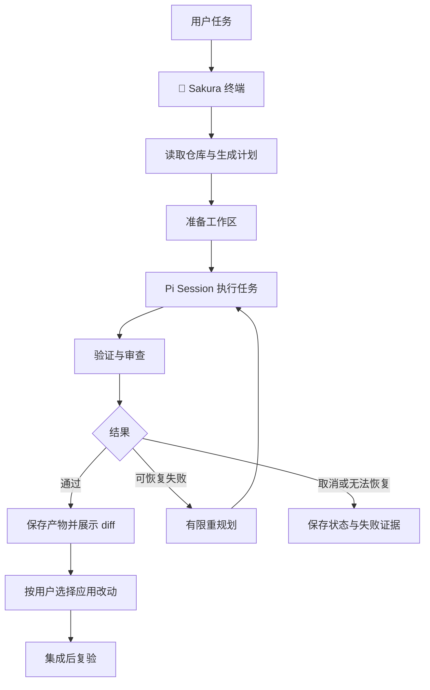

# 🌸 Sakura Coding Agent 开发计划

文档版本：0.6 已交付审计 · 日期：2026-10-13 · 上游：[earendil-works/pi](https://github.com/earendil-works/pi)

## 0. 设计依据与采用方式

本计划参考以下两份项目文档，并结合现有源码编排剩余任务：

| 参考文档 | 采用内容 | 在本计划中的落点 |
| --- | --- | --- |
| [架构与开发路线](架构与开发路线.md) | §4–7 任务模型、DAG 与调度；§9–13 仓库上下文、隔离与验证；§15–16 经验与 Trace；§18–29 分阶段实现、Demo 和评测 | 五个核心模块、S0–S5、交付标准与评测任务 |
| [Pi 复用指南](Pi复用指南.md) | §3–10 SDK/Extension/RPC 边界、薄 runtime、角色权限与状态复用；§11–16 版本合同、复用审计和完成条件 | Pi 接入规则、权限审计、升级与任务完成模板 |

技术边界存在历史差异时，采用 Pi 复用指南的口径：SDK 为主、Extension 用于入口和交互、RPC 按实际需求采用；`runtime/` 只做创建、配置和事件接线。架构路线中的 `PiAgentAdapter`、独立 Tool Registry、自建 compaction 文件等示例按此收敛。

本轮用户要求上游更新易同步、减少不必要包装，优先级高于旧部署取舍。[ADR-003](reuse-decisions.md) 将目标切换为官方包与公开类型，必要时使用原样上游源码构建；ADR-001/002 保留解释当前代码的历史背景。已迁移到官方 1.1.0；旧源码和类型备份已清理，不再接入运行。

### 首要约束：同步容易，结构简单

- Pi 的单 Agent 功能直接用官方实现和配置；Sakura 新增代码必须对应一个明确的工程任务需求。
- 上游源码保持原样，Sakura 业务代码放在独立目录；升级通过换包版本或切换源码 commit 完成。
- 统一使用同一份 Pi 包及公开类型；官方包管理维护依赖图，Sakura 只声明自己实际使用的直接依赖。
- 只有需要隔离进程或跨语言时才引入 RPC；只有出现第二个真实 Runtime 才提取共同接口。
- 入口、UI、模型、会话和工具沿用 Pi 能力；相应差异通过扩展、主题或必要的配置实现。
- 验收“无需改 Sakura 业务代码的 Pi 升级”是否成为常态，记录每次升级耗时、改动文件和失败原因。

原路线的 8 周安排是完整系统的参考排期。本计划是基于已有代码的增量计划，工期须重新估算；个人使用版、协作版和完成五个模块评测的完整版本分别验收。文档版本、当前 package 版本与产品里程碑分别记录。

## 1. 产品目标

做一个自己愿意每天使用的编码 Agent：输入任务，Sakura 理解仓库、给出计划、修改代码、运行项目检查，并交付可审阅的改动与证据。樱花风格贯穿启动页、主题、任务进度和报告。

完整产品沿用原路线定位：**Pi Runtime + Dynamic Planning + Multi-Agent Orchestrator + Repo Intelligence + Worktree/Sandbox + Experience/Skill Evolution**。Verification 贯穿执行与失败恢复，是公共闭环能力。个人使用版是实现这套系统的第一个可用交付点。

第一版默认面向个人开发者，以 macOS/Linux 终端和 TypeScript/JavaScript 仓库为主要场景。本地与云端模型配置沿用 Pi；当前 local-only 作为 Sakura 的执行策略保留。这些是本轮规划假设，可在实际使用后调整。

### 核心场景

| 场景 | 用户输入示例 | 交付物 |
| --- | --- | --- |
| 理解仓库 | “解释登录流程，指出相关文件” | 路径、符号和证据支持的说明 |
| 修复问题 | “修复刷新 token 失效的问题” | 修复 diff、检查结果、失败原因 |
| 开发功能 | “增加配置导出功能” | 任务计划、实现、必要测试、使用说明 |
| 审查改动 | “检查当前 diff 是否有问题” | 具体问题、文件位置和建议 |
| 继续任务 | “继续上一次中断的任务” | 恢复后的任务状态、待办和最终交付 |

### 首版范围

- 一个可安装的 Sakura Pi package，沿用 Pi CLI 加载插件、提示词、技能与主题；需要短命令时提供简单启动别名。
- Sakura Night / Sakura Light 两套主题，以及简洁的启动页和状态栏。
- 先规划再执行的工作流；简单任务走短流程，复杂任务显示依赖图。
- 编码、检查、查看 diff、应用改动的完整交付流程。
- 可取消的任务、可靠的运行记录，以及失败时保留产物。
- Pi 原生模型配置与选择，加上 Sakura 任务的连接失败与降级提示。

多 Agent 的依赖产物传递、自动重规划、调用图和经验晋升安排在基础闭环之后。樱花入口与主题的实现复用 Pi TUI，把主要研发时间留给五个核心模块。Web/桌面客户端、跨机器调度和其他语言的深度索引放入后续版本。

## 2. 仓库现状

截至 2026-10-13，S0–S5 共 32 项交付均有实现和相应证据；本地全量检查 147/147、Linux 全量检查 148/148 通过，Pi 插件体检通过。个人版四项编码和一次只读审查通过，真实候选效果对照因候选 8/9 低于基线 9/9 而拒绝晋升；240 项 Pi / Pi+community / Sakura 与消融矩阵已完成。此结论代表本轮定义范围完成，不代表早期 8 周路线中的跨语言图分析、重复模式聚类、录屏和普遍多 Agent 增益全部完成。逐项边界与证据见[完成度审计](完成度审计.md)和[实施记录](实施记录.md)。

| 能力 | 已实现与验证 | 剩余工作 |
| --- | --- | --- |
| Pi 集成 | 官方 1.1.0 类型/SDK/CLI，同一安装；候选隔离与回退 | 持续跑最新候选与远端 CI |
| 樱花入口 | 原生 package 安装、Night/Light、阶段 widget；真彩和原生 256 色调色板对比度与预览已检查 | 不同用户终端配色可继续抽样 |
| 计划/交付 | 保存并执行同一计划；完整 binary Git 产物、显式应用与复验；四项真实编码产物重放通过 | 完整重复评测与更多真实仓库抽样 |
| 控制/恢复 | 全轮取消、原子检查点、Pi 会话引用、恢复未完成节点、有限重规划 | 更多长期故障注入 |
| 补充指令 | 原生 steer/follow-up 定向投递；pending 节点在调度点改计划版本 | 长任务交互反馈 |
| 仓库理解 | TS checker 引用/调用、hash 增量索引、Context Pack 预算与来源 | 动态调用/其他语言仍用 read/grep |
| 工作区 | 普通 run 可选任务独立 worktree；依赖产物集成后传递；冲突和取消恢复保留证据 | 真实模型下继续检验复杂 DAG |
| 权限/指标 | 宿主/嵌套/验证路径策略；macOS 与 Linux bwrap/seccomp 受保护回放；事实 usage，未知值保留 | Linux 已在 bubblewrap 0.4.0 主机通过全量回归；旧版过滤会使部分 Node `spawnSync` 命令失败关闭；工具策略不防宿主 root，也不等同完整虚拟机边界 |
| 经验/评测 | 经验绑定证据，候选完整工件回执、可信审批、所有权、事务恢复/回退；固定任务、三组矩阵和消融均有报告 | 本候选因回归被正确拒绝；小样本不证明普遍收益；重复模式聚类未验收 |

完整快照通过临时 Git index 保存新增/删除/重命名/二进制，不修改用户 staging。保存失败保留工作区；产物成功保存后才能清理。

## 3. 技术方案与 Pi 复用

### 上游与版本策略

- 用户指定的上游为 `https://github.com/earendil-works/pi`。
- 官方 1.1.0 基线对应 tag `v1.1.0`、commit `abe508e1b89912adde45528136c3221eb69acdd7`；历史内嵌源码基线为 `71dca871bc80b6bc97be37f0ca3189399d651fff`。详见兼容记录。
- 官方在线文档跟随最新版本，不能直接视为当前副本的 API 合同。主题 schema、SDK 和扩展类型以最终锁定版本的源码为准。
- 常规升级：在临时候选分支/工作区更新官方包与 lockfile → 运行兼容检查 → 记录版本、差异与结果 → 接受候选。失败时丢弃候选，当前可用版本保留。
- 需要跟进尚未发布的上游改动时：维护独立、原样的 Pi 检出，固定到具体 commit，按该版本上游说明构建；仍通过相同的官方包名和公开导出接入。源码放入工作目录即可阅读，不从内部文件路径调用。
- 迁移完成后移除闭包复制、包名重写、生成的入口再导出、手写 Pi API 声明，以及为源码副本单独维护的依赖/类型错误白名单。业务 AgentRunner 只保留调度和结果判定所需接口。
- 上游 release 触发定期检查或依赖更新 PR；对 `main` 的检查按需运行，解析为具体 commit。接受升级需通过检查，兼容范围以实测为准。
- 当前独立 package 将运行依赖直接锁定为 Pi 1.1.0，并随 Sakura profile 使用；Pi package/插件模式按宿主规则解析，兼容范围以实测记录为准。不得把“peer `*`”写成当前 package 的发布事实：`package.json` 没有 `peerDependencies`，且当前版本标为 private。宿主/SDK 解析一致性只在已验证安装路径内声明。
- 保留 Pi 的许可、版权与来源信息，核对源码副本及分发产物中的声明。

旧复制重写脚本已退出执行路径，保留迁移备份。新候选流程始终写临时目录，检查当前 package/lockfile SHA256 未变。

升级完成条件：候选失败不破坏当前版本；能加载 Sakura package、创建受限 Session、执行必要工具、取得 usage 并验证 cancel/恢复；普通兼容升级只更新版本、lockfile 与兼容记录。新增上游错误要查明原因，不扩大宽泛的忽略范围。

### 模块职责

Pi 提供模型调用、Agent Loop、工具执行、会话、资源加载、扩展和 TUI。官方仓库介绍了这些基础包；Sakura 在它们之上实现产品入口和工程任务流程。[Pi 源码与包说明](https://github.com/earendil-works/pi)

Pi 支持通过主题 JSON、TypeScript 扩展和 SDK 定制界面与应用行为。Sakura 主题和 UI 优先走这些机制；具体签名在编码前对照锁定源码。[主题文档](https://pi.dev/docs/latest/themes)、[扩展文档](https://pi.dev/docs/latest/extensions)、[SDK 文档](https://pi.dev/docs/latest/sdk)

接入策略：Pi CLI 承载交互与资源加载，Extension 注册 Sakura 命令、工具、钩子和 UI；任务执行通过 SDK 创建 Session。新增 Pi 依赖集中在 `runtime/`，直接使用公开导出与类型；现有源码副本内部引用在 S0 迁移时清除。

基础工具、MCP transport、Skill 发现加载和会话 compaction 复用 Pi 或锁定版本的现有实现。Sakura Skill Router 负责选择与效果跟踪；原有五个基础技能继续使用。锁定 Pi 已提供的能力直接采用，额外社区包只补实际缺口；逐项记录采用方式、工具暴露范围、版本、许可证和替代成本，移除未被使用的 vendor 副本。

| 层 | 位置 | 职责 |
| --- | --- | --- |
| 入口 | Pi CLI、现有 `src/cli/` | Pi 提供交互与配置；Sakura CLI 保留业务操作 |
| 界面 | `themes/`、现有扩展的 Pi UI 钩子 | 配色、必要品牌与任务状态展示 |
| Pi 接线 | `src/runtime/` | 直接用 SDK 创建/配置 Session，采集少量业务所需事件 |
| 任务规划 | `src/planning/` | 计划、依赖校验、失败重规划 |
| 执行编排 | `src/orchestrator/` | 调度、上下文和依赖产物传递 |
| 仓库理解 | `src/repo-intelligence/` | 索引、影响面和相关测试 |
| 工作区与交付 | `src/workspace/` | 隔离、保存改动、应用与冲突处理 |
| 验证 | `src/verification/` | 项目检查、证据、失败分类 |
| 记录与经验 | `src/telemetry/`、`src/experience/` | 运行状态、报告、经验检索 |

扩展入口数按需要独立加载/开关的行为确定，内部模块继续分文件。先复用现有入口展示樱花 UI；只有明确加载边界需要时才新增扩展文件。模型选择、鉴权、会话浏览等入口直接使用 Pi。业务报告与 Trace 只保存任务必要数据，Pi 消息和完整事件继续由 Pi 维护。

### 上下文、调度与权限约束

- Planner 输入包括任务、仓库证据、Git 状态、相关技能、经验、工具能力与执行策略；输出受 schema 与 DAG 校验约束，重规划递增版本并保留旧图。
- Scheduler 的启动条件同时包含依赖满足、写范围无冲突、并发槽可用和资源预算允许。未知写范围按保守策略串行；简单任务退化为单 Agent。
- Repo Intelligence 生成有路径、符号、行号与来源的 Context Pack，按模型窗口设置输入预算并预留输出空间；先用可解释的排名、去重与片段裁剪。Pi compaction 继续处理会话历史。
- 子 Agent 的权限计算覆盖内置工具、Extension、自定义工具和 MCP；同时核对其资源加载，防止不应暴露的委托工具进入子 Agent。
- 首版落实路径、命令、网络与凭证访问策略，策略沿真实执行入口应用。Worktree 隔离代码改动；强系统隔离另行接容器/沙箱后端，界面与文档准确描述隔离级别。
- 验证失败先分类：局部问题走有限 retry，任务边界或依赖问题走 replan；超限保留证据并结束。经验晋升沿用 `candidate → replay/eval → review → promoted`，支持版本回退。

### 运行状态与交付约定

运行阶段已使用 `idle → planning → running → verifying → ready_to_apply → applied`；无验证为 `unverified`，失败和取消分别为 `failed`、`cancelled`。检查结果另外记录 `passed / failed / not_run`，应用状态另外记录 `pending / applied / conflict`。节点 TaskStatus 与整轮 RunPhase 分别保存，UI 消费 `run.phase` 及节点事件。

`ready_to_apply` 表示产物已保存且声明的检查通过。没有可用检查时报告 `not_run`，并提示待验证。任务执行完成、检查通过和改动已应用是三个独立事实。

恢复时读取运行检查点及 Pi Session 引用，再核对 base commit、当前改动和产物。已经完成的节点不重复执行；若工作区/基础版本检查不通过，恢复会拒绝继续并要求以新运行重新规划，不会静默地在旧运行里自动重规划。取消后停止后续调度，等待工具退出并落盘，再结束运行。

运行中补充指令复用 Pi steer/follow-up。Sakura 负责选择接收指令的节点并处理 DAG 变更；涉及计划修改的指令在调度安全点生效，避免已运行节点的任务定义被直接改写。

## 4. 里程碑

以下是单人开发的粗估，按有效工作日计算，需在 S0 之后修订。每个阶段以验收结果结束。

| 阶段 | 估算 | 交付 | 出口条件 |
| --- | --- | --- | --- |
| S0 基线与产物 | 4–6 天 | 官方包迁移、同步检查、权限审计、交付修复 | Pi 更新候选可接受或回退；产物可重放 |
| S1 樱花入口 | 2–3 天 | Pi package、Night/Light、必要 UI | 从干净环境加载 Sakura 并沿用 Pi 配置 |
| S2 日常闭环 | 5–7 天 | 计划展示、任务执行、权限策略、应用改动 | 三个真实编码任务输出 diff 与验证证据 |
| S3 控制与恢复 | 4–6 天 | 取消、steer、持久化、恢复、有限重规划 | 中断恢复无重复修改、失败无假成功 |
| S4 协作与仓库能力 | 7–10 天 | 依赖产物传递、隔离集成、Context Pack、经验检索 | 下游看到上游产物；冲突可恢复；上下文预算生效 |
| S5 评测与发布 | 3–5 天 | 任务集、基线、安装包、使用文档 | 可复现安装和完整验收报告 |

S0–S3 的 P0 任务是个人使用版的发布门槛；S4–S5 补齐协作、仓库与经验评测。首版整体粗估 3–5 周有效工作时间；完整路线参照原 8 周计划并在 S0 后调整。运行中 steer 与技能晋升可以在相应后续版本验收。

### 与原路线的阶段对应

| 原路线 | 本轮任务 | 对应验收 |
| --- | --- | --- |
| Week 1 / 复用 Phase 0 | S0、S1-01、S2-02 | 公开 SDK 接入、可回退更新、真实 usage 与工具权限 |
| Week 2 / Phase 1 | S0-03/04、S2 | 单 Agent 的实现、检查、diff、失败反馈与 Trace |
| Week 3–4 / Phase 2 | S2-01/05、S3、S4-01 | 小/中/大任务的不同 DAG；重规划；并发、依赖和控制 |
| Week 5 / Phase 3 | S4-03/04/06 | Symbol/Import/Test/Reference、影响面、Context Pack 和预算 |
| Week 6 / Phase 4 | S2-06、S4-01/02 | 隔离写任务、集成、冲突恢复与集成后复验 |
| Week 7 / Phase 5 | S4-07、S4-05 | 经验检索与重复任务对比；候选技能评测、审阅、晋升 |
| Week 8 / Phase 6 | S5-01/02/03 | 三组基线、消融、真实数据与可安装交付 |

第一份 Demo 沿用原路线 §22 的小型 TS token-refresh 问题：定位 auth/token 与相关测试 → 生成计划 → 修复 → 检查 → diff review → 保存证据。随后增加两路探索和源码/测试隔离集成，用同一任务逐步验证协作收益。该 Demo 的 repo、commit 和成功条件需固定到任务文件。

## 5. 验收与衡量

开发阶段使用现有离线测试体系；模型端到端验收单独运行并记录模型、基础 commit、命令和输出。以下是开发与发布验收要求；已完成检查见实施记录。

- 从安装到首次启动有一条明确路径；无凭证或模型不可用时给出可操作说明。
- 修复问题、增加新文件、只读审查各有真实任务验收。
- 检查失败、取消和连接错误都不能显示为成功。
- Coding Task 完成需检查 diff，并执行所有适用的 lint/typecheck/test/build；无自动命令时提供可审查的替代验证，无任何验证证据则保留“未验证”。
- 新增、删除、重命名、二进制与未跟踪文件在产物中可完整恢复；无法保存时保留工作区。
- 应用改动前检查 base commit 与用户未提交修改；冲突时保留双方数据。
- 重启后能查看历史运行，并恢复可恢复的任务。
- 深浅主题、窄终端、中文路径、无颜色和 emoji 降级可用。

衡量任务成功率、检查通过率、人工介入次数、耗时、token、工具/Agent 调用、文件读取、上下文 token、重试、重规划和冲突数。未知费用标为未知；同一模型、参数、任务、基础版本、timeout、工具权限与机器环境下比较 **A = Pi、B = Pi + 锁定社区插件组合、C = Sakura**。首轮建议 10 个小型真实任务，每个至少重复 3 次，报告原始结果。

消融分别关闭 Multi-Agent、Repo Intelligence、Worktree Isolation 和 Experience Retrieval；另比较固定工作流与动态规划，说明对成功率、调用数、上下文与重复失败的影响。五个模块的收益都需有可复现数据。

每个开发任务在开工前填写 Reuse Check / Build vs Reuse，完成时提供输入输出契约、结构化错误、关键 Trace、适合该改动的离线与集成验收证据、文档和真实 Demo 结果。调度器验证使用 FakeAgentRunner，模型端到端验收判断仓库结果与证据。

## 6. 当前交付状态

S0–S5 已按任务清单完成验收。候选技能安全生命周期验收通过的是包含效果门槛拒绝分支的系统；本次候选结果 8/9，因低于基线 9/9 未发布。S5-02 的 240 项矩阵全部结束，但仅代表报告写明的单模型、单机和固定任务。Codex / Pi 调研后的明确功能清单也已实现，新增项目说明、预算/取消、代码撤销、MCP、Python AST 和经验模式分组；本地全量 160/160，详见[实施与验收](CODING_CAPABILITIES.md)。完整多语言 LSP、逐 hunk 编辑与第二轮跨环境效果评估仍在后续范围。当前 tarball 由 Pi 1.1.0 独立宿主验收；历史 Linux 源码副本通过 bwrap/seccomp 全量检查，本轮新能力未重跑 Linux，也未更新原 work TUI。详细核心任务映射见[完成度审计](完成度审计.md)。视觉细节见 [樱花风格规范](樱花风格规范.md)。
