# Sakura Coding Agent：可实施架构与开发路线

> 设计依据（历史文档）。当前实施状态以[完成度审计](完成度审计.md)和[开发计划](开发计划.md)为准；Pi 接入原则见 [Pi 复用指南](Pi复用指南.md)。
>
> 基于 Pi Runtime 二次开发的多智能体软件工程系统。  
> 本文将两份项目路线合并，并进一步落到**模块边界、目录结构、数据结构、运行流程、接口、架构图、开发顺序、GitHub Issues、验收标准和 Benchmark**，目标是可以直接照着开始开发，而不是继续停留在概念设计。

> **实施状态说明（2026-10-13）：** 本文 W1–W8 的空 checkbox 是初始计划模板，不是当前状态。实施范围经过 Pi 复用指南和 S0–S5 清单收敛。32 项当前交付及 Linux bwrap/seccomp 验收已完成；本路线中被收敛取代或仍未验收的部分（例如单 Runtime PiAgentAdapter、重复模式聚类、跨语言图、演示录制和多 Agent 普遍收益）见[完成度审计](完成度审计.md)。不要将本路线的每个设计目标都理解为已实现。

---

## 0. 项目一句话定位

**Sakura Coding Agent = Pi Runtime + Dynamic Planning + Multi-Agent Orchestration + Repository Intelligence + Isolated Workspace + Verification Loop + Experience/Skill Evolution。**

不做：

- Pi + 一堆插件 + 改名 Sakura
- 从零重写 Pi / Codex
- 为了“全自研”重造 Model SDK、Agent Loop、TUI、Shell、MCP SDK

重点解决 Pi Runtime 之上的软件工程问题：

1. **任务应该怎么动态拆解？**
2. **哪些任务应该并行，哪些存在依赖？**
3. **多个 Agent 如何协同而不是简单 spawn？**
4. **Agent 如何真正理解大型 Repository？**
5. **多个 Agent 如何隔离修改代码？**
6. **代码修改后如何强制验证并失败重规划？**
7. **历史成功/失败经验如何在后续任务中复用？**

---

# 1. 最终总体架构

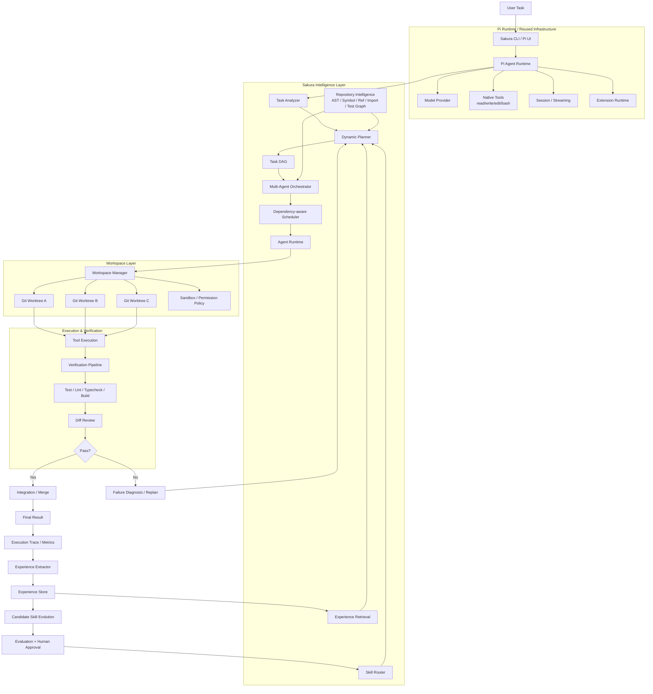

---

# 2. 模块取舍：什么复用，什么自研

| 模块 | 策略 | 优先级 | 说明 |
|---|---|---:|---|
| Model Provider | 复用 Pi | - | 不重复造轮子 |
| 基础 Agent Loop | 复用 Pi | - | 需要读懂，不需要重写 |
| Session / Streaming | 复用 Pi | - | 基础设施 |
| Read / Write / Edit / Bash | 复用 Pi | - | 基础工具 |
| TUI / CLI 基础交互 | 尽量复用 Pi | - | 不作为卖点 |
| MCP Protocol | 复用现有实现 | P2 | Sakura 只做统一 Tool Adapter |
| Skills 加载 | 复用 + Router | P2 | 不做几百个 Skill |
| Subagent Spawn | 参考 `pi-subagents` | P0 | 只把它当底层执行能力 |
| **Dynamic Planning** | **自研** | **P0** | 核心 |
| **Task DAG / Replanning** | **自研** | **P0** | 核心 |
| **Multi-Agent Orchestrator** | **自研** | **P0** | 核心 |
| **Repository Intelligence** | **自研** | **P0** | 核心 |
| **Worktree Isolation** | **自研** | **P0** | 核心 |
| **Verification Loop** | **自研** | **P0** | 核心 |
| Sandbox / Guardrails | Pi + Sakura 增强 | P1 | 和 Worktree 配套 |
| Experience Engine | 自研 | P1 | 后期 |
| Skill Evolution | 自研 | P2 | 最后做 |
| Telemetry / Benchmark | 自研 | P1 | 项目证明材料 |

核心原则：

> **Pi 负责“一个 Agent 怎么运行”；Sakura 负责“一个软件工程任务怎么被理解、拆解、调度、执行、验证、复盘”。**

---

# 3. 推荐代码目录

```text
SakuraCodingAgent/
├── packages/
│   ├── sakura-core/
│   │   └── src/
│   │       ├── planning/
│   │       │   ├── task-analyzer.ts
│   │       │   ├── planner.ts
│   │       │   ├── dag-builder.ts
│   │       │   ├── replanner.ts
│   │       │   ├── schemas.ts
│   │       │   └── validator.ts
│   │       │
│   │       ├── orchestrator/
│   │       │   ├── orchestrator.ts
│   │       │   ├── scheduler.ts
│   │       │   ├── dependency-resolver.ts
│   │       │   ├── agent-registry.ts
│   │       │   ├── agent-runner.ts
│   │       │   ├── result-aggregator.ts
│   │       │   └── lifecycle.ts
│   │       │
│   │       ├── repo/
│   │       │   ├── indexer.ts
│   │       │   ├── parser.ts
│   │       │   ├── symbol-index.ts
│   │       │   ├── reference-index.ts
│   │       │   ├── import-graph.ts
│   │       │   ├── call-graph.ts
│   │       │   ├── test-mapper.ts
│   │       │   ├── git-index.ts
│   │       │   ├── retrieval.ts
│   │       │   └── impact-analysis.ts
│   │       │
│   │       ├── workspace/
│   │       │   ├── workspace-manager.ts
│   │       │   ├── worktree.ts
│   │       │   ├── conflict-detector.ts
│   │       │   ├── integration.ts
│   │       │   └── sandbox-policy.ts
│   │       │
│   │       ├── verification/
│   │       │   ├── verifier.ts
│   │       │   ├── command-detector.ts
│   │       │   ├── test-runner.ts
│   │       │   ├── diff-reviewer.ts
│   │       │   └── failure-classifier.ts
│   │       │
│   │       ├── context/
│   │       │   ├── context-builder.ts
│   │       │   ├── token-budget.ts
│   │       │   ├── ranker.ts
│   │       │   └── compaction.ts
│   │       │
│   │       ├── skills/
│   │       │   ├── registry.ts
│   │       │   ├── router.ts
│   │       │   └── loader.ts
│   │       │
│   │       ├── mcp/
│   │       │   ├── adapter.ts
│   │       │   └── tool-registry.ts
│   │       │
│   │       ├── experience/
│   │       │   ├── extractor.ts
│   │       │   ├── store.ts
│   │       │   ├── retrieval.ts
│   │       │   ├── cluster.ts
│   │       │   └── skill-candidate.ts
│   │       │
│   │       └── telemetry/
│   │           ├── trace.ts
│   │           ├── metrics.ts
│   │           └── events.ts
│   │
│   └── sakura-cli/
│       └── src/
│           ├── index.ts
│           └── commands/
│
├── skills/
│   ├── systematic-debugging/
│   ├── tdd/
│   ├── code-review/
│   ├── planning/
│   └── verification/
│
├── benchmarks/
│   ├── tasks/
│   ├── runners/
│   ├── baselines/
│   └── reports/
│
├── docs/
│   ├── architecture.md
│   ├── pi-runtime.md
│   ├── planning.md
│   ├── orchestrator.md
│   ├── repo-intelligence.md
│   ├── workspace.md
│   ├── verification.md
│   └── benchmark.md
│
├── examples/
└── tests/
```

> 如果当前项目直接基于 Pi monorepo 二开，不必机械照搬 `packages/` 层级；关键是保持这些模块边界，避免所有逻辑塞进一个 extension 文件。

---

# 4. 核心数据模型

## 4.1 Task

```ts
export type TaskStatus =
  | "pending"
  | "ready"
  | "running"
  | "blocked"
  | "succeeded"
  | "failed"
  | "cancelled";

export type AgentRole =
  | "explorer"
  | "planner"
  | "architect"
  | "implementer"
  | "tester"
  | "reviewer"
  | "researcher";

export interface TaskNode {
  id: string;
  title: string;
  description: string;

  role: AgentRole;
  dependencies: string[];

  status: TaskStatus;
  priority: number;

  readScope?: string[];
  writeScope?: string[];

  verification?: VerificationSpec[];

  retryCount: number;
  maxRetries: number;

  result?: TaskResult;
}
```

## 4.2 TaskGraph

```ts
export interface TaskGraph {
  id: string;
  rootTask: string;
  version: number;

  nodes: Record<string, TaskNode>;
  edges: Array<{
    from: string;
    to: string;
  }>;

  createdAt: number;
  updatedAt: number;
}
```

要求：

- 必须是 DAG；
- 每个 dependency 必须存在；
- 写任务前尽可能确定 `writeScope`；
- Planner 输出后先做 schema validation，再进入执行；
- Replan 产生 `version + 1`，旧图保留到 trace。

---

# 5. 一次完整任务的运行时流程

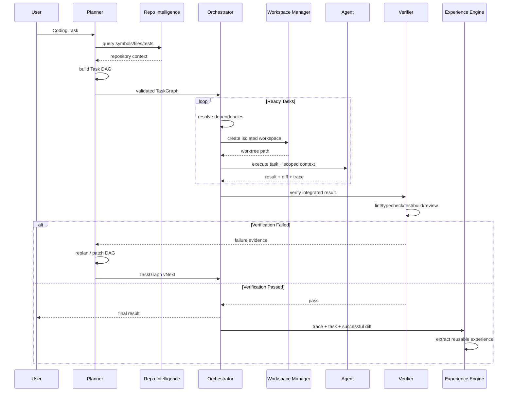

---

# 6. Dynamic Planning

Planning 和 Orchestrator 必须拆开：

```text
Planner      = 决定做什么
Orchestrator = 决定谁做、什么时候做、在哪里做
```

## 6.1 Task Analyzer

先判断任务复杂度，而不是任何任务都启动多个 Agent。

```ts
interface TaskAnalysis {
  type: "edit" | "bugfix" | "feature" | "refactor" | "research";
  complexity: "small" | "medium" | "large";
  likelyFiles: string[];
  requiresRepoExploration: boolean;
  requiresParallelism: boolean;
  requiresArchitecture: boolean;
  risk: "low" | "medium" | "high";
}
```

建议规则：

```text
README typo
→ Edit → Verify

单文件 Bug
→ Explore → Implement → Verify

跨模块 Bug
→ Explore A ┐
            ├→ Diagnose → Implement → Test → Review
  Explore B ┘

大型 Feature
→ 多路 Explore → Architect → 多路 Implement → Integration → Verify
```

## 6.2 Planner 输入

```text
User Task
+ Repo Intelligence
+ Current Git State
+ Relevant Skills
+ Retrieved Experience
+ Tool Availability
+ Execution Policy
```

## 6.3 Planner 输出

只允许输出结构化 `TaskGraph`，不要让 Scheduler 解析自由文本。

## 6.4 Replanning

触发条件：

- 测试失败且不是简单一次性修复；
- 发现新的依赖模块；
- 原任务节点不可执行；
- Agent 返回 `needs_replan`；
- Worktree 合并冲突暴露错误任务边界；
- 连续 retry 超限。

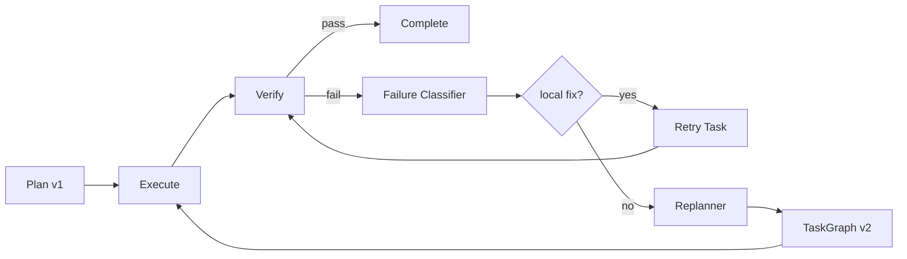

---

# 7. Multi-Agent Orchestrator

不要把 Orchestrator 写成 `Promise.all(spawnAgent(...))`。

## 7.1 内部组件

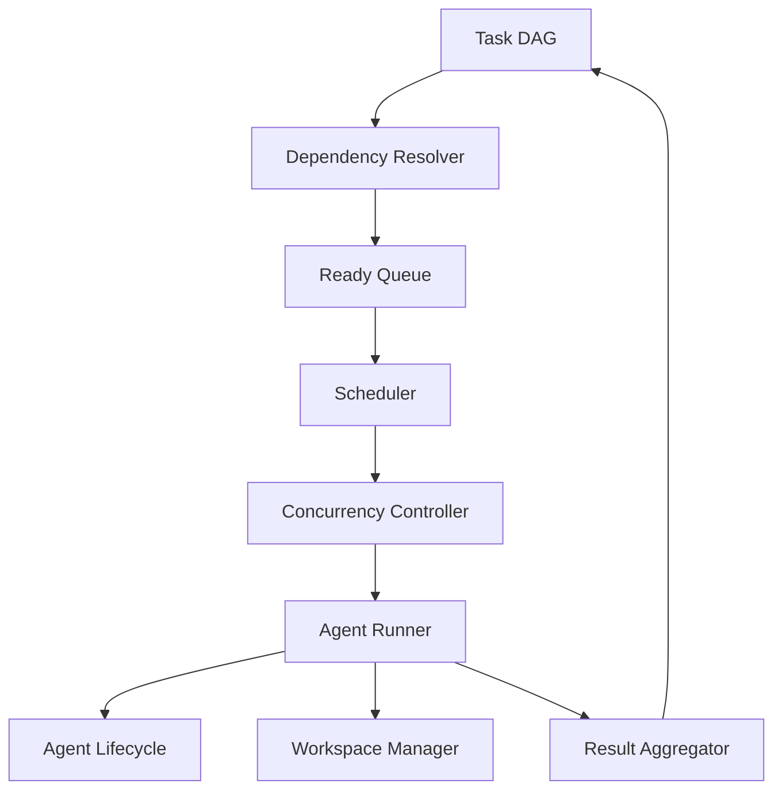

## 7.2 Scheduler 最小算法

伪代码：

```ts
while (!graphFinished(graph)) {
  const ready = getReadyTasks(graph);

  const runnable = ready
    .filter(task => !hasWriteConflict(task, runningTasks))
    .slice(0, concurrencyLimit);

  await Promise.all(
    runnable.map(task => runTask(task))
  );

  updateGraphFromResults();

  if (shouldReplan()) {
    graph = await replanner.replan(graph, failures);
  }
}
```

## 7.3 不是什么任务都并行

并行条件至少包括：

```text
dependencies 满足
AND writeScope 不冲突
AND concurrency slot 可用
AND 资源预算允许
```

例如：

```text
explore-auth ─┐
              ├── design-auth
explore-db ───┘

design-auth ──┬── implement-auth
              └── implement-tests

implement-auth ──┐
                 ├── integration-test
implement-tests ─┘
```

---

# 8. Agent 生命周期

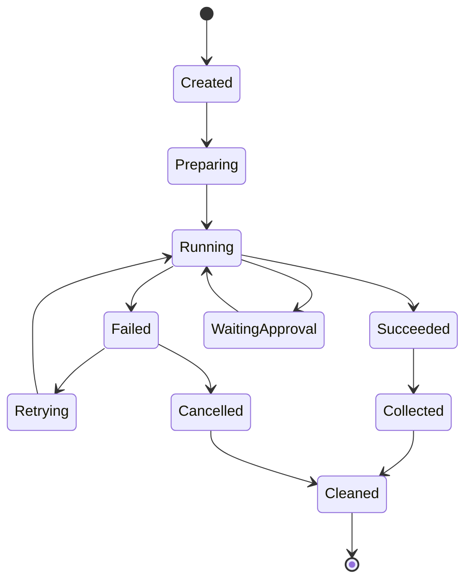

建议 AgentRunner 对 Pi 暴露一个很薄的适配层：

```ts
interface AgentRunner {
  run(input: AgentRunInput): Promise<AgentRunResult>;
}

interface AgentRunInput {
  agentId: string;
  role: AgentRole;
  task: TaskNode;
  workspacePath: string;
  context: ContextBundle;
  allowedTools: string[];
  timeoutMs: number;
}

interface AgentRunResult {
  status: "success" | "failure" | "needs_replan";
  summary: string;
  changedFiles: string[];
  diff?: string;
  evidence: string[];
  tokenUsage?: number;
  toolCalls?: number;
}
```

这样未来 Pi 内部 API 变化时，只改 Adapter，不污染 Sakura 核心逻辑。

---

# 9. Repository Intelligence

这一模块不要和 Pi 自带的 Context Compression 混为一谈。

```text
Pi Context Compression：
“上下文已经太长，怎么压缩？”

Sakura Repository Intelligence：
“当前任务真正需要理解 Repository 的哪些结构？”
```

## 9.1 Index Pipeline

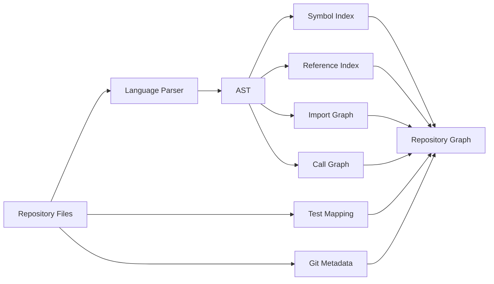

第一版不要追求所有语言。

建议 MVP：

```text
TypeScript / JavaScript
↓
再考虑 Python
```

## 9.2 Repo Graph 节点

```ts
type RepoNode =
  | FileNode
  | SymbolNode
  | TestNode
  | ModuleNode;

interface SymbolNode {
  id: string;
  name: string;
  kind: "function" | "class" | "method" | "variable" | "interface";
  file: string;
  startLine: number;
  endLine: number;
}
```

边：

```text
FILE_CONTAINS_SYMBOL
IMPORTS
REFERENCES
CALLS
TESTS
DEPENDS_ON
CHANGED_WITH
```

## 9.3 对 Agent 暴露的查询 API

```ts
findSymbol(name)
findReferences(symbolId)
findCallers(symbolId)
findCallees(symbolId)
getDependencies(fileOrSymbol)
getDependents(fileOrSymbol)
findRelatedTests(fileOrSymbol)
getChangedSymbols()
analyzeImpact(fileOrSymbol)
searchRelevantCode(query, budget)
```

## 9.4 Context Ranking

可以先使用可解释的加权规则，不必第一版就上 embedding/vector DB。

```text
score =
  0.30 * keyword
+ 0.25 * symbol
+ 0.15 * dependency
+ 0.15 * test_relation
+ 0.10 * git_change
+ 0.05 * recency
```

权重先作为配置，不宣称最优；后续通过 benchmark 调。

---

# 10. Context Builder 与 Token Budget

Repo Intelligence 负责“找什么”，Context Builder 负责“给 Agent 多少”。

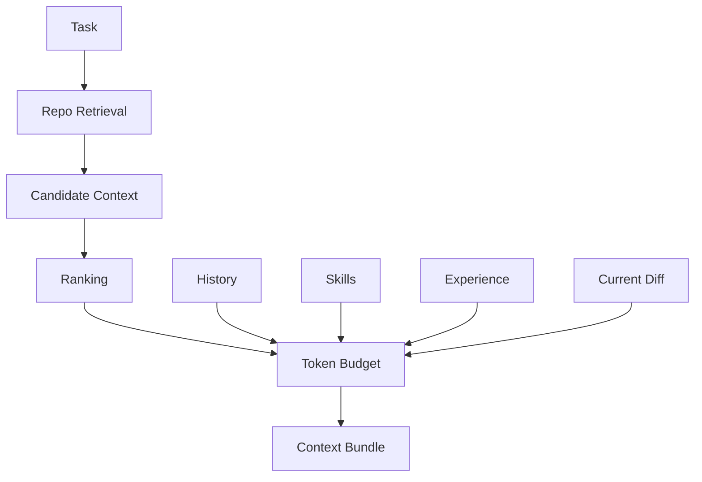

示例预算：

```text
Total                 64K
├── System             5K
├── Task / Plan         4K
├── Skills              3K
├── Experience          3K
├── Repository Code    30K
├── Tool Results        7K
├── History             8K
└── Reserve             4K
```

超限顺序：

1. 移除低相关候选文件；
2. 去掉重复代码片段；
3. 压缩旧 Tool Result；
4. 压缩旧 History；
5. 保留当前任务、当前 Diff、关键依赖和测试；
6. 不要为了自研而替换 Pi 已经做得好的基础 context compaction。

---

# 11. Worktree Isolation

这是 Multi-Agent 真正可工程化的关键。

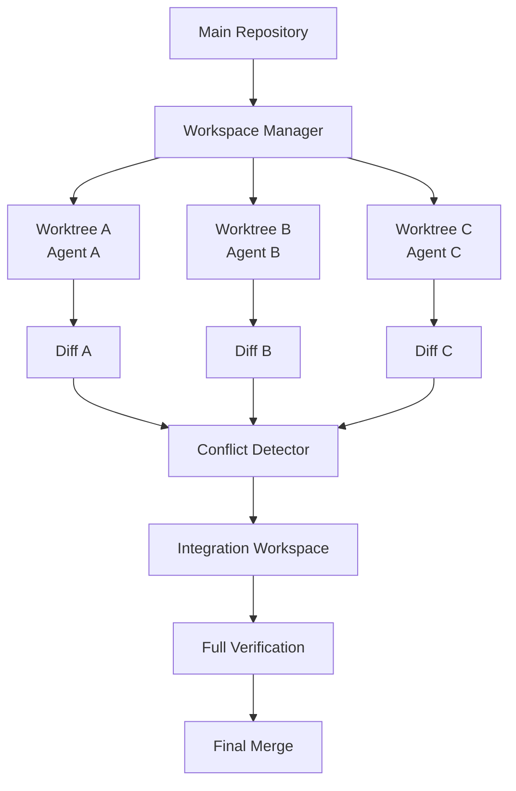

## 11.1 AgentSession

```ts
interface AgentSession {
  agentId: string;
  taskId: string;

  branch: string;
  worktreePath: string;

  baseCommit: string;

  changedFiles: string[];
  diff?: string;

  startedAt: number;
  endedAt?: number;
}
```

## 11.2 WorkspaceManager

```ts
interface WorkspaceManager {
  createWorkspace(task: TaskNode): Promise<AgentSession>;
  runInWorkspace(session: AgentSession, command: string): Promise<CommandResult>;
  collectDiff(session: AgentSession): Promise<string>;
  detectConflict(sessions: AgentSession[]): Promise<ConflictReport>;
  integrate(sessions: AgentSession[]): Promise<IntegrationResult>;
  cleanup(session: AgentSession): Promise<void>;
}
```

第一版实现优先级：

```text
P0 create worktree
P0 collect diff
P0 cleanup
P0 detect overlapping changed files
P1 cherry-pick / patch integration
P1 merge conflict recovery
P2 smarter semantic conflict analysis
```

---

# 12. Sandbox / Permission

Worktree 解决代码隔离，但不等于 Sandbox。

第一版可以先做 Policy Layer：

```text
workspace 内 read       allow
workspace 内 write      allow
workspace 外 read       configurable
workspace 外 write      deny
git push                approval
危险 shell              approval / deny
网络访问                 configurable
删除大量文件             approval
修改密钥/配置目录         deny / approval
```

接口：

```ts
interface ToolPolicy {
  evaluate(action: ToolAction): PolicyDecision;
}

type PolicyDecision =
  | { type: "allow" }
  | { type: "deny"; reason: string }
  | { type: "approval"; reason: string };
```

不要第一版就自己实现容器级 OS Sandbox。先把 Agent 工作目录和危险行为约束清楚，后续再接 Docker / container runtime。

---

# 13. Verification-driven Workflow

项目必须坚持：

> **No verification, no completion.**

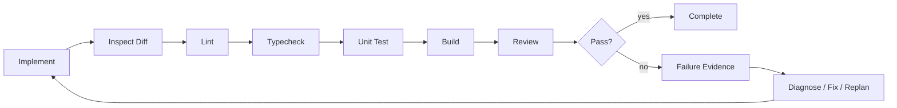

不是所有项目都有全部命令，因此需要 `CommandDetector`：

```text
package.json
pyproject.toml
Makefile
Cargo.toml
go.mod
CI config
README / CONTRIBUTING
```

得到：

```ts
interface VerificationPlan {
  lint?: string[];
  typecheck?: string[];
  test?: string[];
  build?: string[];
  custom?: string[];
}
```

最终 `VerificationResult` 必须包含证据：

```ts
interface VerificationResult {
  passed: boolean;
  steps: Array<{
    command: string;
    exitCode: number;
    durationMs: number;
    stdoutTail: string;
    stderrTail: string;
  }>;
  reviewedDiff: boolean;
  failures: VerificationFailure[];
}
```

Agent 最终不能只说“应该修好了”。

---

# 14. Skill Router 与 MCP

这两块是基础能力，不要占用主要研发周期。

## Skill

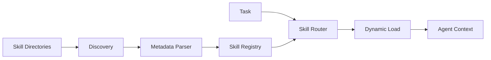

第一版只准备 5 个：

```text
systematic-debugging
tdd
code-review
planning
verification
```

## MCP

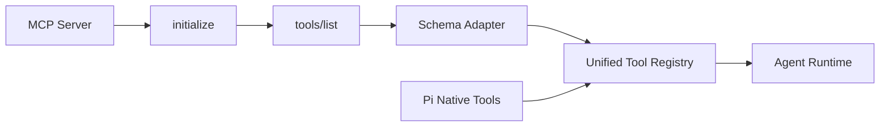

Sakura 自己维护统一 Tool 描述：

```ts
interface SakuraTool {
  name: string;
  description: string;
  inputSchema: unknown;
  source: "pi" | "mcp" | "sakura";
  execute(args: unknown): Promise<unknown>;
}
```

---

# 15. Experience Engine

这一模块放在主闭环稳定以后。

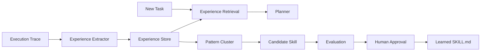

## Experience Schema

```ts
interface Experience {
  id: string;

  problemPattern: string;
  symptoms: string[];

  failedAttempts: string[];
  successfulActions: string[];

  usefulTools: string[];
  relevantFiles: string[];

  verificationEvidence: string[];

  tags: string[];
  createdAt: number;
}
```

关键原则：

```text
不是：
Agent 自动修改核心 system prompt

而是：
Trace
→ Experience
→ Retrieval
→ Candidate Skill
→ Evaluation
→ Human Approval
→ Learned Skill
```

这样更可控，也更容易 benchmark。

---

# 16. Telemetry / Trace

没有 Trace，后面几乎无法做 Benchmark、Replanning 和 Experience。

统一事件模型：

```ts
type SakuraEvent =
  | { type: "task.created"; taskId: string }
  | { type: "plan.created"; graphVersion: number }
  | { type: "task.started"; taskId: string; agentId: string }
  | { type: "tool.called"; agentId: string; tool: string }
  | { type: "task.finished"; taskId: string; status: string }
  | { type: "verification.started" }
  | { type: "verification.finished"; passed: boolean }
  | { type: "replan.triggered"; reason: string }
  | { type: "workspace.created"; path: string }
  | { type: "workspace.cleaned"; path: string };
```

每次 run 建议生成：

```text
.sakura/runs/<run-id>/
├── task.json
├── task-graph-v1.json
├── task-graph-v2.json
├── events.jsonl
├── metrics.json
├── agents/
│   ├── explorer-01.jsonl
│   └── implementer-01.jsonl
├── diffs/
└── verification.json
```

---

# 17. 模块依赖关系

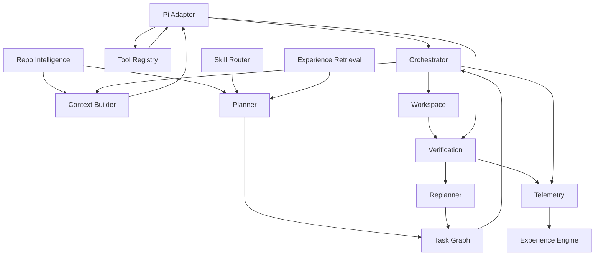

推荐依赖方向：

```text
planning       不依赖 orchestrator 实现
orchestrator   只依赖 TaskGraph 接口
repo           不依赖 agent
workspace      不依赖 planner
verification   不依赖 planner
experience     依赖 trace，不侵入核心执行路径
```

这样才能单测和替换。

---

# 18. MVP 分阶段

## v0.1：单 Agent 软件工程闭环

```text
Pi Runtime
+ Task Analyzer
+ 固定 Coding Workflow
+ Verification
+ Trace
```

必须能：

```bash
sakura "修复这个项目中的 xxx bug"
```

然后真实完成：

```text
Explore
→ Plan
→ Implement
→ Test
→ Diff Review
→ Fix if needed
→ Complete
```

## v0.2：Dynamic Planning

加入：

```text
TaskGraph
DAG Builder
Dependency Validator
Replanning
```

## v0.3：Multi-Agent

加入：

```text
Scheduler
Concurrency
Agent Registry
Parallel Explore
Result Aggregation
```

## v0.4：Repo Intelligence

加入：

```text
Symbol Index
Reference / Import Graph
Related Test Mapping
Context Retrieval
Impact Analysis MVP
```

## v0.5：Isolated Workspace

加入：

```text
Git Worktree
Diff Collection
Conflict Detection
Integration
```

## v0.6：Experience

加入：

```text
Experience Extraction
Retrieval
Candidate Skill
```

## v1.0：Benchmark / Resume Release

```text
真实任务
Baselines
Ablation
Metrics
Demo
README
Architecture
```

---

# 19. 8 周可执行开发计划

## Week 1 — Pi Integration + Skeleton

目标：不是学 Python/Git，而是弄清 Pi 执行路径并建立 Adapter。

### Issues

- [ ] `W1-01` 跟踪 Pi CLI → Agent Runtime → Model → Tool → Result
- [ ] `W1-02` 跟踪 Extension 注册流程
- [ ] `W1-03` 跟踪 Skill 加载
- [ ] `W1-04` 跟踪 Subagent 创建
- [ ] `W1-05` 跟踪 Session / Context
- [ ] `W1-06` 创建 Sakura monorepo/module skeleton
- [ ] `W1-07` 实现 `PiAgentAdapter`
- [ ] `W1-08` 建立 Trace/Event 基础设施

### 验收

你可以不看源码图，自己解释：

```text
Pi 怎么调用模型
Tool Call 怎么执行
Extension 怎么注册
Skill 怎么加载
Subagent 怎么创建
Context 怎么传
Session 怎么保存
Sakura 插在哪一层
```

---

## Week 2 — Coding Workflow + Verification

### Issues

- [ ] `W2-01` Task Analyzer MVP
- [ ] `W2-02` Workflow State Machine
- [ ] `W2-03` Command Detector
- [ ] `W2-04` Verification Pipeline
- [ ] `W2-05` Diff Collector
- [ ] `W2-06` Diff Reviewer
- [ ] `W2-07` Failure Evidence
- [ ] `W2-08` 跑通真实仓库 Demo

### 状态机

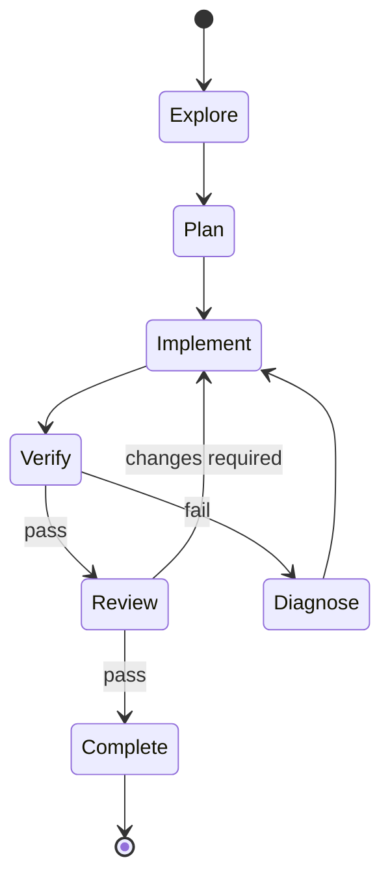

### 验收

至少 3 个真实小任务能够：

- 修改代码；
- 自动执行项目验证命令；
- 验证失败后修复；
- 最终输出真实 diff + test evidence。

---

## Week 3 — Dynamic Planning

### Issues

- [ ] `W3-01` TaskNode schema
- [ ] `W3-02` TaskGraph schema
- [ ] `W3-03` DAG Validator
- [ ] `W3-04` Planner structured output
- [ ] `W3-05` Dependency Resolver
- [ ] `W3-06` Replanner
- [ ] `W3-07` Graph versioning
- [ ] `W3-08` Planner unit tests

### 验收

准备三类任务：

```text
Small  → 2 个节点左右
Medium → 4~6 个节点
Large  → 出现并行分支
```

验证 Planner 不会所有任务都生成固定流水线。

---

## Week 4 — Multi-Agent Orchestrator

### Issues

- [ ] `W4-01` Agent Registry
- [ ] `W4-02` Agent Runner Adapter
- [ ] `W4-03` Ready Queue
- [ ] `W4-04` Scheduler
- [ ] `W4-05` Concurrency Limit
- [ ] `W4-06` Retry / Timeout / Cancel
- [ ] `W4-07` Result Aggregator
- [ ] `W4-08` Agent execution trace
- [ ] `W4-09` Parallel exploration demo

### 验收

```text
✓ 自动任务拆解
✓ DAG dependency
✓ 2~3 Agent 并行
✓ failure retry
✓ result aggregation
✓ execution trace
```

---

## Week 5 — Repository Intelligence

### Issues

- [ ] `W5-01` 文件扫描和 ignore
- [ ] `W5-02` TS/JS Parser
- [ ] `W5-03` Symbol Index
- [ ] `W5-04` Import Graph
- [ ] `W5-05` Reference MVP
- [ ] `W5-06` Test Mapping
- [ ] `W5-07` Git changed-file metadata
- [ ] `W5-08` Retrieval / Ranking
- [ ] `W5-09` Context Builder
- [ ] `W5-10` Impact Analysis MVP

### 验收

对于一个指定 symbol：

```text
find definition
find imports/dependencies
find references
find related tests
find likely impacted files
```

并证明 Agent 可以利用结果减少无关文件读取。

---

## Week 6 — Worktree + Integration

### Issues

- [ ] `W6-01` Workspace Manager
- [ ] `W6-02` create/remove worktree
- [ ] `W6-03` Agent command cwd isolation
- [ ] `W6-04` collect per-agent diff
- [ ] `W6-05` changed-file conflict detection
- [ ] `W6-06` integration workspace
- [ ] `W6-07` merge/cherry-pick strategy
- [ ] `W6-08` post-integration verification
- [ ] `W6-09` Tool Policy MVP

### 验收

两个 Agent 同时开发：

```text
Agent A → source change
Agent B → tests
```

各自在独立 worktree 完成，最后整合并通过测试。

---

## Week 7 — Experience / Skill Evolution

### Issues

- [ ] `W7-01` Experience schema
- [ ] `W7-02` Experience Extractor
- [ ] `W7-03` local store
- [ ] `W7-04` retrieval
- [ ] `W7-05` inject experience into Planner
- [ ] `W7-06` repeated-pattern clustering MVP
- [ ] `W7-07` Candidate Skill generation
- [ ] `W7-08` Evaluation + Approval flow

### 验收

人为构造重复问题：

```text
第一次：无经验
第二次：检索第一次成功经验
```

比较：

```text
tool calls
time
tokens
failed attempts
```

---

## Week 8 — Benchmark + Release

### Baselines

```text
A = Pi 原生
B = Pi + Community Plugins
C = Sakura
```

### Ablation

```text
Sakura Full
Sakura - Multi-Agent
Sakura - Repo Intelligence
Sakura - Worktree Isolation
Sakura - Experience Retrieval
```

### Metrics

```text
Task Success Rate
Test Pass Rate
Token Usage
Execution Time
Tool Calls
Agent Calls
Retry Count
Files Read
Context Tokens
Replan Count
Merge Conflict Count
Cost
```

### Issues

- [ ] `W8-01` Benchmark task format
- [ ] `W8-02` Baseline runner
- [ ] `W8-03` Sakura runner
- [ ] `W8-04` Metrics exporter
- [ ] `W8-05` Ablation flags
- [ ] `W8-06` Run real tasks
- [ ] `W8-07` Analyze results
- [ ] `W8-08` README
- [ ] `W8-09` Architecture docs
- [ ] `W8-10` Demo recording/script
- [ ] `W8-11` Resume bullet

**所有结果实测，不预填数字。**

---

# 20. GitHub Milestones

```text
Milestone 0 — Foundation
  W1

Milestone 1 — Sakura v0.1
  W2

Milestone 2 — Dynamic Agent Runtime
  W3 + W4

Milestone 3 — Repository-aware Agent
  W5

Milestone 4 — Isolated Multi-Agent Coding
  W6

Milestone 5 — Experience Engine
  W7

Milestone 6 — Sakura v1.0
  W8
```

推荐 Label：

```text
area:planning
area:orchestrator
area:repo
area:workspace
area:verification
area:skills
area:mcp
area:experience
area:telemetry

priority:p0
priority:p1
priority:p2

type:feature
type:bug
type:test
type:docs
type:benchmark
```

---

# 21. 第一个 Sprint 直接怎么开工

如果现在就开始，不要同时写五个核心模块。

按下面顺序：

```text
Step 1
找到 Pi 的“执行一次 agent task”的最薄调用边界
        ↓
Step 2
包成 PiAgentAdapter
        ↓
Step 3
建立 SakuraEvent + RunTrace
        ↓
Step 4
实现单 Agent Workflow
        ↓
Step 5
实现 Verification
        ↓
Step 6
用真实 repo 跑通一个 bugfix
        ↓
Step 7
再抽象 TaskGraph
```

第一阶段最重要的接口：

```ts
export interface PiAgentAdapter {
  run(input: {
    prompt: string;
    cwd: string;
    role?: string;
    allowedTools?: string[];
  }): Promise<{
    text: string;
    toolCalls: unknown[];
    usage?: unknown;
  }>;
}
```

先让 Sakura Core 不直接依赖 Pi 到处的内部类型。

---

# 22. 推荐的第一个端到端 Demo

不要一开始选超大型 GitHub Issue。

准备一个小型 TypeScript 项目，故意放入：

```text
src/
├── auth/
│   ├── auth-service.ts
│   └── token-service.ts
└── users/
tests/
└── auth.test.ts
```

Bug：

> refresh token 过期处理错误，导致 refresh 后返回旧 token。

让 Sakura 完成：

```text
1. Task Analyzer 判断为 medium bug
2. Explore auth-service
3. Explore token-service
4. 找到 auth.test.ts
5. Planner 生成 DAG
6. 两个 Explore 可并行
7. Implementer 修改代码
8. Tester 修改/补充测试
9. Worktree 隔离
10. Integration
11. npm test
12. Review diff
13. 输出 evidence
```

这个 Demo 可以同时覆盖：

```text
Planning
DAG
Multi-Agent
Repo Intelligence
Worktree
Verification
Trace
```

Experience 暂时不需要。

---

# 23. 测试策略

## Unit Test

重点测确定性模块：

```text
DAG Validator
Dependency Resolver
Ready Queue
Scheduler
Conflict Detector
Token Budget
Ranker
Verification Command Detector
Experience Store
```

## Integration Test

```text
Planner → TaskGraph
TaskGraph → Scheduler
Scheduler → FakeAgentRunner
Workspace → Git fixture
Verification → fixture repo
```

## Agent/E2E Test

模型输出有随机性，因此判断最终状态：

```text
是否修改正确文件
是否通过测试
是否满足 issue
是否留下验证证据
```

不要只 snapshot LLM 文本。

---

# 24. FakeAgentRunner：开发时非常重要

不要每次测试 Scheduler 都烧模型 token。

```ts
class FakeAgentRunner implements AgentRunner {
  constructor(
    private responses: Record<string, AgentRunResult>
  ) {}

  async run(input: AgentRunInput) {
    return this.responses[input.task.id];
  }
}
```

这样可以确定性测试：

```text
A/B parallel
C waits A/B
A failure retry
B timeout
C cancellation
Replan
```

---

# 25. 配置文件建议

```yaml
# sakura.config.yaml

runtime:
  maxConcurrency: 3
  taskTimeoutMs: 600000

planning:
  maxTasks: 12
  maxReplans: 3

repository:
  languages:
    - typescript
    - javascript
  maxIndexedFileSizeKb: 512

context:
  totalBudget: 64000
  reserve: 4000
  topKFiles: 12

workspace:
  mode: worktree
  cleanup: true

verification:
  requireDiffReview: true
  requireTestsWhenAvailable: true

policy:
  gitPush: approval
  externalWrite: deny
  destructiveShell: approval

experience:
  enabled: true
  autoCreateSkill: false
```

---

# 26. CLI 设计

第一版够用即可：

```bash
sakura "修复登录 token refresh bug"

sakura run "实现 issue #123"

sakura inspect plan

sakura inspect trace

sakura inspect repo AuthService

sakura benchmark ./benchmarks/tasks/auth-refresh.yaml
```

执行时可显示：

```text
Sakura Run #a93f

[PLAN]
✓ task analyzed: medium bug
✓ graph created: 6 tasks

[RUN]
✓ explore-auth       explorer-01   8.2s
✓ explore-token      explorer-02   7.9s
✓ diagnose           planner-01
✓ implement          coder-01
✓ tests              tester-01

[VERIFY]
✓ typecheck
✓ 18 tests passed
✓ build
✓ diff reviewed

[RESULT]
changed files: 3
replans: 0
agents: 5
```

这些数据必须来自 Trace，而不是 UI 自己猜。

---

# 27. Benchmark Task 格式

```yaml
id: auth-refresh-001

repo:
  url: "<real repository>"
  commit: "<fixed commit hash>"

task:
  description: |
    Fix ...

verification:
  commands:
    - npm test
    - npm run typecheck

success:
  requireExitCodeZero: true

limits:
  timeoutMinutes: 30
```

真实 GitHub Issue 场景还需要固定 base commit，避免基线之间代码版本不同。

---

# 28. Benchmark 实验设计注意事项

必须控制：

```text
相同模型
相同模型参数
相同任务
相同 base commit
相同 timeout
尽可能相同 tool 权限
相同机器环境
```

否则不能把差异直接归因于 Sakura。

建议每个任务多次运行，因为 Agent 存在随机性。

结果只记录真实值：

| Variant | Success | Tests | Tokens | Time | Tool Calls | Files Read | Replans |
|---|---:|---:|---:|---:|---:|---:|---:|
| Pi | 待实测 | 待实测 | 待实测 | 待实测 | 待实测 | 待实测 | - |
| Pi + Plugins | 待实测 | 待实测 | 待实测 | 待实测 | 待实测 | 待实测 | - |
| Sakura | 待实测 | 待实测 | 待实测 | 待实测 | 待实测 | 待实测 | 待实测 |

---

# 29. 项目风险与降级方案

## 风险 1：Repo Graph 做太大

降级：

```text
AST 全调用图
↓
先做 Symbol + Import + Test Mapping
```

## 风险 2：多 Agent 成本暴涨

降级：

```text
Planner complexity gate
small task → single agent
medium/large → multi-agent
```

## 风险 3：Worktree 合并复杂

降级：

```text
先禁止两个 implementer 写相同文件
→ changed-file conflict
→ 串行执行冲突节点
```

## 风险 4：Replanning 不稳定

降级：

```text
只允许 Verification Failure 触发
maxReplans = 2~3
```

## 风险 5：Skill Evolution 太玄学

降级：

```text
只做 Experience Retrieval
Skill Evolution 放 v1.1
```

---

# 30. 明确不做

```text
× 从零 LLM SDK
× 从零完整 Agent Loop
× 自研 TUI
× 自研 Shell
× 自研 Read/Write/Edit
× 完整重写 MCP SDK
× 几百个 Skills
× IDE
× Web UI
× 第一版支持十几个模型
× 为“全自研”大量 fork Pi Core
× 第一版支持所有编程语言
× 第一版做复杂向量数据库
× 第一版做完整容器 Sandbox
```

时间投入应该集中在：

```text
Dynamic Planning       ██████████
Multi-Agent            ██████████
Repo Intelligence      ██████████
Worktree Isolation     ████████
Verification           ███████
Benchmark              ██████
Experience             █████
Skills / MCP           ███
UI                     █
```

---

# 31. Sakura 的最终核心卖点

## 1. Dynamic Planning + DAG

```text
Task analysis
Task decomposition
Dependency graph
Dynamic replanning
Complexity-aware execution
```

## 2. Multi-Agent Orchestration

```text
Dependency-aware scheduling
Parallel execution
Concurrency control
Retry / timeout / cancellation
Result aggregation
```

## 3. Repository Intelligence

```text
AST / Symbols
References
Import / dependency graph
Related tests
Impact analysis
Repository-aware retrieval
```

## 4. Isolated Agent Workspace

```text
Git Worktree
Per-agent workspace
Diff collection
Conflict detection
Integration
```

## 5. Verification-driven Workflow

```text
Implement
→ Lint / Typecheck / Test / Build
→ Diff Review
→ Fix / Replan
→ Verified Completion
```

## 6. Experience / Skill Evolution

```text
Execution Trace
→ Experience
→ Retrieval
→ Candidate Skill
→ Evaluation
→ Approval
```

MCP、Skills、Git、Shell、模型支持属于基础能力，不放在 README 第一屏当核心创新。

---

# 32. README 首页架构图建议

```text
                     Sakura Coding Agent
                            │
                     ┌──────▼──────┐
                     │ Pi Runtime  │
                     └──────┬──────┘
                            │
                 ┌──────────▼──────────┐
                 │   Dynamic Planner   │
                 │ Task DAG / Replan   │
                 └──────────┬──────────┘
                            │
                 ┌──────────▼──────────┐
                 │ Multi-Agent         │
                 │ Orchestrator        │
                 └─────┬────────┬──────┘
                       │        │
              ┌────────▼──┐  ┌──▼─────────┐
              │ Repo      │  │ Skills /   │
              │ Intel     │  │ Experience │
              └────────┬──┘  └────────────┘
                       │
               ┌───────▼────────┐
               │ Worktree /     │
               │ Sandbox Layer  │
               └───────┬────────┘
                       │
               ┌───────▼────────┐
               │ Execute        │
               │ Test / Review  │
               └───────┬────────┘
                       │
                 fail  │  pass
                 ┌─────┴─────┐
                 ▼           ▼
              Replan       Result
                              │
                              ▼
                         Experience
```

---

# 33. 简历项目描述模板

> **Sakura Coding Agent — 基于 Pi Runtime 的多智能体软件工程 Agent**
>
> 基于 Pi Runtime 二次开发 Coding Agent，在复用模型调用、基础 Agent Loop 与 Tool Runtime 的基础上，自研动态任务规划与 DAG 调度、多 Agent 并行编排、Repository Graph 代码理解、Git Worktree 隔离执行及验证驱动的软件工程闭环；构建执行 Trace 与 Experience Retrieval，并通过真实代码任务对 Pi 原生、Pi + 社区扩展和 Sakura 进行成功率、Token、执行时间及工具调用等指标对比与消融实验。

等 Benchmark 真正跑完后，再把**真实结果**加入简历，不能提前编百分比。

---

# 34. Definition of Done

一个功能只有满足下面条件才算完成：

```text
[ ] 有明确 interface / schema
[ ] 有 unit test
[ ] 有至少一个 integration test
[ ] Trace 能记录关键事件
[ ] 错误有结构化返回
[ ] 文档说明输入/输出
[ ] 不依赖人工观察 LLM 文本判断成功
```

一个 Coding Task 只有满足：

```text
[ ] 代码修改完成
[ ] diff 已检查
[ ] 可用 lint 已执行
[ ] 可用 typecheck 已执行
[ ] 可用 tests 已执行
[ ] 可用 build 已执行
[ ] 失败已经修复或明确报告
[ ] 最终 evidence 已记录
```

才允许进入 `COMPLETE`。

---

# 35. 最终实施顺序

```text
Pi Runtime Integration
        ↓
PiAgentAdapter
        ↓
Trace / Telemetry
        ↓
Single-Agent Coding Workflow
        ↓
Verification Loop
        ↓
TaskGraph / Dynamic Planning
        ↓
Multi-Agent Scheduler
        ↓
Repository Intelligence
        ↓
Context Builder
        ↓
Git Worktree Isolation
        ↓
Integration / Conflict Handling
        ↓
Experience Retrieval
        ↓
Skill Evolution
        ↓
Benchmark / Ablation
        ↓
Sakura v1.0
```

最关键的一点：

> **不要同时开发五个“大模块”。先让每一层都有可运行的端到端版本，再往下一层加能力。**

第一个真正值得提交的版本不是“支持 MCP/Skills”，而是：

```text
User Task
→ Sakura
→ 修改真实代码
→ 自动验证
→ 留下完整 Trace
→ 给出可检查的 Diff 和 Evidence
```

之后再逐步证明：

```text
Dynamic Planning 是否减少无意义 Agent？
Multi-Agent 是否提高复杂任务完成能力？
Repo Intelligence 是否减少无关上下文？
Worktree 是否让并行修改真正安全？
Experience Retrieval 是否减少重复失败？
```

这些问题最终都应该由 **Benchmark 数据**回答，而不是 README 文案回答。
